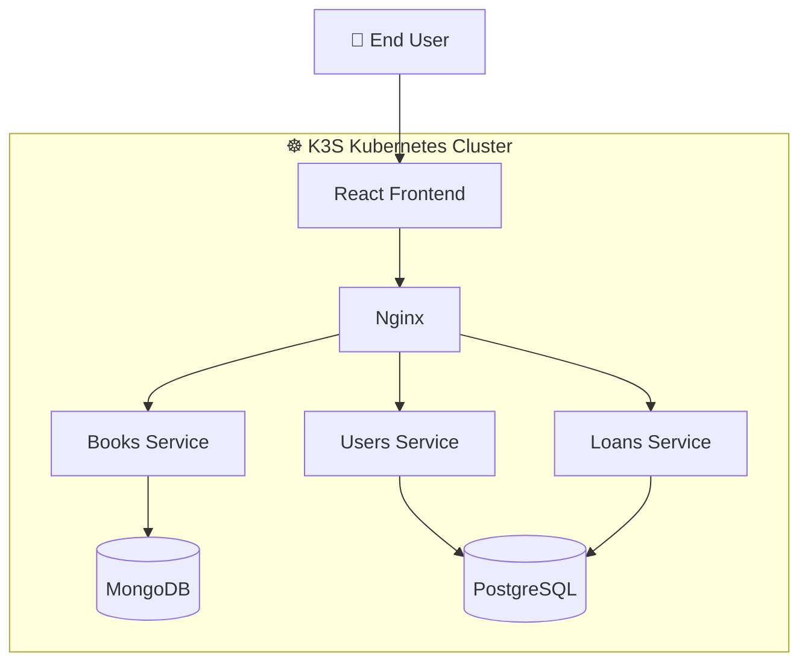

# 📚 Library Management System – Full Stack K8S

<p align="center">
  <strong>A Microservices-Based Library Management Platform Deployed on Kubernetes</strong>
</p>

<p align="center">
  
  
  
  
  
</p>

---

## 🚀 Overview

**Library Management System** is a full-stack application built around a microservices architecture to manage library operations.

The platform consists of a React frontend and three independent backend microservices, each responsible for a specific business domain:

- 📖 **Books Service:** Manages library books and catalog information.
- 👤 **Users Service:** Handles user-related operations.
- 🔄 **Loans Service:** Manages book borrowing and return operations.

The application leverages Docker for containerization and K3S for lightweight Kubernetes orchestration, providing a modular and scalable deployment environment.

## 🏗️ System Architecture

The application follows a distributed architecture with independent services and dedicated database technologies.

| Component | Technology | Database |
|:---|:---|:---|
| **Frontend** | React + Vite + Nginx | — |
| **MS1 – Books** | Node.js + Express | MongoDB |
| **MS2 – Users** | Node.js + Express | PostgreSQL |
| **MS3 – Loans** | Node.js + Express | PostgreSQL |

### Architecture Diagram



## 🛠️ Technology Stack

| Category | Technologies |
|:---|:---|
| **Frontend** | React, Vite, Nginx |
| **Backend** | Node.js, Express.js |
| **Databases** | MongoDB, PostgreSQL |
| **Containerization** | Docker, Docker Compose |
| **Orchestration** | K3S, K3D |
| **Kubernetes Management** | kubectl, Kustomize |
| **Package Management** | Helm |
| **Version Control** | Git, GitHub |

## 📋 Prerequisites

Make sure the following tools are installed:

- [Docker Desktop](https://www.docker.com/products/docker-desktop/)
- [Node.js 24+](https://nodejs.org/)
- [K3D](https://k3d.io/)
- [kubectl](https://kubernetes.io/docs/tasks/tools/)
- [Helm](https://helm.sh/)

## 💻 Local Development

### 1. Clone the Repository

```bash
git clone https://github.com/ghaziarif1/library-management-k8s.git
```

### 2. Navigate to the Project Directory

```bash
cd library-management-k8s
```

### 3. Build and Start the Application

```bash
docker compose up --build
```

### 4. Stop the Application

```bash
docker compose down
```

## ☸️ Kubernetes Deployment (K3S)

The application can be deployed on a lightweight Kubernetes cluster using K3D.

### 1. Create the Cluster

```bash
k3d cluster create library-cluster --port "8080:80@loadbalancer" --agents 1
```

### 2. Deploy the Application

Apply the development Kubernetes configuration using Kustomize:

```bash
kubectl apply -k k8s/overlays/dev
```

### 3. Verify the Deployment

Check cluster nodes:

```bash
kubectl get nodes
```

Check application pods:

```bash
kubectl get pods -A
```

Check Kubernetes services:

```bash
kubectl get svc -A
```

### 4. Access the Application

If the frontend is exposed through the configured K3D load balancer on port 8080, access:

```text
http://localhost:8080
```

## 📁 Project Structure

```text
library-management-k8s/
│
├── frontend/                  # React + Vite frontend
│
├── services/
│   ├── books/                 # Books microservice
│   ├── users/                 # Users microservice
│   └── loans/                 # Loans microservice
│
├── k8s/
│   └── overlays/
│       └── dev/               # Kubernetes development manifests
│
├── docker-compose.yml         # Local development orchestration
│
└── README.md
```

*Note: The directory structure is illustrative and should match the actual repository.*

## 🎯 Key Learning Objectives

- Design and implement a microservices-based application.
- Develop independent backend services using Node.js and Express.
- Integrate relational and NoSQL databases.
- Containerize application components with Docker.
- Orchestrate microservices using Kubernetes (K3S).
- Manage Kubernetes configurations using Kustomize.
- Understand distributed application deployment and service communication.

## 👨‍💻 Author

**Ghazi Arif**

Master's Student in DevOps & Cloud Computing

**Institution:** ISET Tozeur

**Academic Year:** 2026–2027

<p align="center">
  <a href="https://github.com/ghaziarif1">GitHub Profile</a>
  &nbsp; • &nbsp;
  <a href="https://github.com/ghaziarif1/library-management-k8s">Project Repository</a>
</p>

---

<p align="center">
  <strong>☸️ Built with Docker, Kubernetes & Microservices</strong>
  <br/>
  <sub>Learn • Build • Automate • Deploy</sub>
</p>